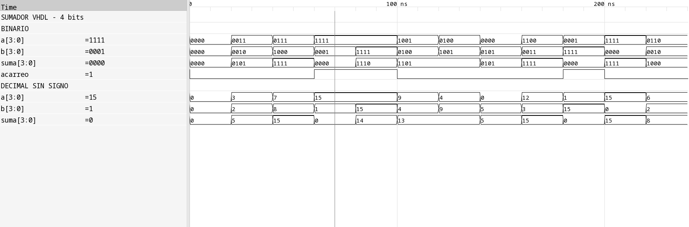
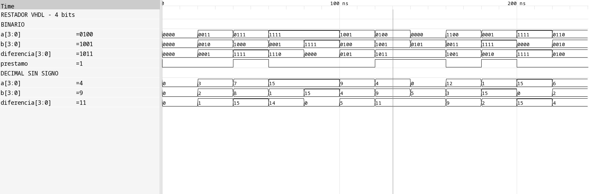
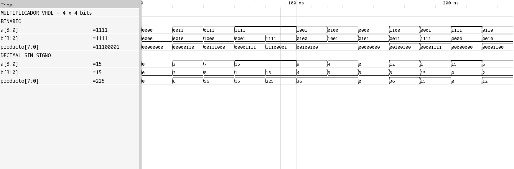
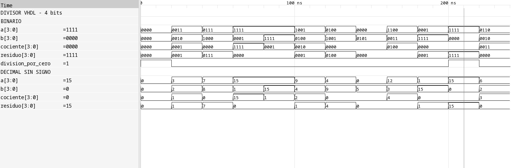
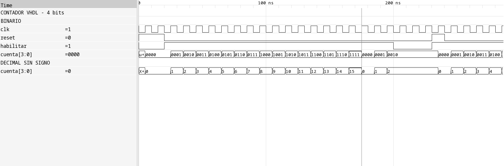

# Electrónica Digital

Resultados de las prácticas de laboratorio de **Electrónica Digital** del programa de Ingeniería de Sistemas y Computación de la **Universidad Tecnológica de Pereira**.

Este repositorio reúne las descripciones de hardware y las evidencias de simulación de los circuitos desarrollados. Su propósito es mostrar cómo las funciones estudiadas en los trabajos se traducen en diseños digitales y permitir consultar el código junto con sus resultados.

## Trabajos presentados

### Práctica 3 · Codificación, selección y visualización

El trabajo estudia el multiplexor, el demultiplexor, el codificador de prioridad, el decodificador y el controlador de un display de siete segmentos. Compara las descripciones en VHDL y Verilog y su representación mediante simulación.

Los siguientes diseños están disponibles en [Verilog/código](Verilog/código/):

| Circuito | Resultado que representa | Código |
| --- | --- | --- |
| Multiplexor 2 a 1 | Selección entre dos entradas de 4 bits mediante una señal de control. | [mux.sv](Verilog/código/mux.sv) |
| Demultiplexor 1 a 4 | Enrutamiento de un dato de un bit hacia la salida seleccionada. | [demux.sv](Verilog/código/demux.sv) |
| Codificador de prioridad 4 a 2 | Código de la entrada activa de mayor índice e indicación de entrada válida. | [encoder.sv](Verilog/código/encoder.sv) |
| Decodificador 2 a 4 | Activación de una única salida según el código binario de entrada. | [decoder.sv](Verilog/código/decoder.sv) |

El [banco de pruebas del demultiplexor](Verilog/código/demux_tb.sv) comprueba las ocho combinaciones de entrada y repite el recorrido en orden inverso: 16 comprobaciones en total.

El informe también aborda el display de siete segmentos y las implementaciones VHDL de estos bloques; esos archivos no están incluidos actualmente en `main`. La carpeta [Verilog/imagenes](Verilog/imagenes/) está reservada para sus evidencias y por ahora no contiene capturas.

### Práctica 4 · Aritmética binaria

El trabajo aborda la suma, la resta, la multiplicación, la división y el conteo binario. Los diseños disponibles permiten observar tanto operaciones combinacionales como el comportamiento secuencial de un contador.

| Circuito | VHDL | Verilog / SystemVerilog |
| --- | --- | --- |
| Sumador de 4 bits con acarreo | [sumador.vhd](VHDL/codigo/sumador.vhd) | [sumador.sv](Verilog/código/sumador.sv) |
| Restador de 4 bits con préstamo | [restador.vhd](VHDL/codigo/restador.vhd) | [restador.sv](Verilog/código/restador.sv) |
| Multiplicador de 4 × 4 bits, producto de 8 bits | [multiplicador.vhd](VHDL/codigo/multiplicador.vhd) | [multiplicador.sv](Verilog/código/multiplicador.sv) |
| División entera de 4 bits con cociente, residuo y señal de división por cero | [divisor.vhd](VHDL/codigo/divisor.vhd) | — |
| Contador ascendente de 4 bits, con reset y habilitación | [contador.vhd](VHDL/codigo/contador.vhd) | — |

También se incluye un [multiplicador de 2 × 2 bits](Verilog/código/multiplicador_2bits_en_papel.sv), construido con productos parciales y medios sumadores.

Las operaciones aritméticas usan valores **sin signo**. El restador entrega la diferencia módulo 16 y una señal de préstamo. El divisor VHDL indica la división por cero; en ese caso entrega cociente cero y conserva el dividendo como residuo. El contador avanza de 0 a 15, vuelve a cero y utiliza reset síncrono con prioridad sobre la habilitación.

## Evidencias de simulación

Las capturas VHDL permiten consultar las entradas, las salidas y su evolución temporal. Cada imagen enlaza con su archivo completo.

| Suma | Resta |
| --- | --- |
| [](VHDL/imagenes/sumador.png) | [](VHDL/imagenes/restador.png) |

| Multiplicación | División |
| --- | --- |
| [](VHDL/imagenes/multiplicador.png) | [](VHDL/imagenes/divisor.png) |

**Contador: conteo, pausa y reset**

[](VHDL/imagenes/contador.png)

Las evidencias corresponden a simulación lógica; no acreditan implementación ni mediciones sobre una placa física.

## Organización

```text
.
├── README.md
├── VHDL/
│   ├── codigo/       # Diseños en VHDL
│   └── imagenes/     # Evidencias de simulación
└── Verilog/
    ├── código/       # Diseños y banco de pruebas en SystemVerilog
    └── imagenes/     # Reservada para futuras capturas
```

Los materiales de registros y de la tarea 5 se conservan en la rama [codex/archivos-verilog](https://github.com/Valdefer54/electronica-digital/tree/codex/archivos-verilog), en las carpetas `Informe_Registros_Verilog` y `tarea 5`.

## Consultar y simular los diseños

Para revisar los resultados, abre las capturas anteriores y consulta el módulo correspondiente en las tablas. Los archivos `.sv` utilizan sintaxis de SystemVerilog y pueden cargarse en un entorno compatible, como DigitalJS.

Para ejecutar el banco de pruebas del demultiplexor con **Icarus Verilog**, desde la raíz del repositorio:

```sh
iverilog -g2012 -s demux_tb -o /tmp/electronica-demux_tb Verilog/código/demux.sv Verilog/código/demux_tb.sv
vvp /tmp/electronica-demux_tb
```

El banco está preparado para finalizar con `PASS: 8/8 combinaciones, 16 comprobaciones sin errores.` si todas las salidas coinciden con la tabla de verdad.

Los módulos de `VHDL/codigo/` requieren un simulador compatible con **VHDL-2008**, como GHDL. Las capturas se consultan directamente en el repositorio; los bancos y scripts de reproducción VHDL no forman parte del contenido publicado en `main`.

## Autores

- J. A. Uribe D.
- E. Jaramillo A.
- J. F. Zapata V.

**Universidad Tecnológica de Pereira · Facultad de Ingenierías · Ingeniería de Sistemas y Computación**
